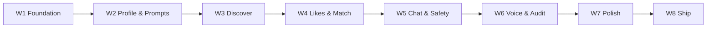

# NADA — 8-Week Roadmap (MVP)

**Goal:** Ship a polished, TestFlight/App Store-ready MVP of NADA (Not a Dating App!) in **8 weeks**.  
**Start:** Monday, **27 July 2026** · **Target launch:** week of **19–25 October 2026**.  
Weeks 1–4 stay on the original calendar. Week 5 (chat & safety, where we paused) restarts **Monday 28 September 2026**; Weeks 6–8 follow.  
**Team:** Dev A = iOS (SwiftUI) · Dev B = Backend + ops.  
**Product source of truth:** [`../UYGULAMA_SEMASI.md`](../UYGULAMA_SEMASI.md)

---

## Week map

| Week | Dates (2026) | Theme | Ships by end of week |
|------|--------------|-------|----------------------|
| 1 | Jul 27 – Aug 2 | Foundation | Auth, User model, app shell, photo upload path |
| 2 | Aug 3 – Aug 9 | Profile & prompts | Full profile setup: photos, prompts, gender, location, preferences |
| 3 | Aug 10 – Aug 16 | Discover | Discovery feed, like/skip, prompt like + comment, undo |
| 4 | Aug 17 – Aug 23 | Likes & match | Incoming/sent likes inbox, mutual match, push notifications |
| 5 | Sep 28 – Oct 4 | Chat & safety | Text chat, report/block (incl. Flirting), unmatch |
| 6 | Oct 5 – Oct 11 | Voice & audit | Voicemail, women-% audit + ops moderation queue |
| 7 | Oct 12 – Oct 18 | Polish | Design system, onboarding tour, hangout ideas, empty states, TR/EN |
| 8 | Oct 19 – Oct 25 | Ship | QA, bugfix, TestFlight, App Store submission, soft launch |

---

## Phase flow

---

## What lands each week (feature detail)

### Week 1 — Foundation (Jul 27–Aug 2)
Auth (Apple + email), `User` model, app shell (tab bar), friends-only onboarding intent, photo upload smoke path. → [`week-01.md`](week-01.md)

### Week 2 — Profile & prompts (Aug 3–9)
Photo gallery (up to 6), prompt catalog + answers (friend-coded), gender (required), location (city + radius), preferences screen, profile edit. → [`week-02.md`](week-02.md)

### Week 3 — Discover (Aug 10–16)
Discovery feed (one profile at a time), like whole profile, **like a prompt/photo with a comment**, skip, **undo last skip**, basic ranking by location + activity. → [`week-03.md`](week-03.md)

### Week 4 — Likes & match (Aug 17–23)
Sent likes + **incoming likes inbox** (“someone liked you”), mutual like → **Match**, match screen, push notifications (match / like). → [`week-04.md`](week-04.md)

### Week 5 — Chat & safety (Sep 28–Oct 4)
Text chat unlocked on match, “your turn” nudge, report/block/unmatch, report reasons incl. **Flirting**, push for new message. → [`week-05.md`](week-05.md)

### Week 6 — Voice & audit (Oct 5–11)
**Voicemail** (async voice, skippable, no video call), microphone permission, **women-% ConnectionStats** job + flagging, minimal **ops moderation queue**. → [`week-06.md`](week-06.md)

### Week 7 — Polish (Oct 12–18)
Design system from §12 palette, first-launch **product tour**, **hangout ideas**, empty/error states, TR + EN strings, accessibility pass, analytics funnel. → [`week-07.md`](week-07.md)

### Week 8 — Ship (Oct 19–25)
Full QA pass, bug bash, privacy policy / KVKK, App Store assets, TestFlight beta, submission, soft launch. → [`week-08.md`](week-08.md)

---

## Milestones

| Milestone | By end of | Meaning |
|-----------|-----------|---------|
| M1 — Account & profile | Week 2 | User can sign in and build a full friends-only profile |
| M2 — Core loop | Week 4 | Discover → like → match works end to end |
| M3 — Talk & stay safe | Week 6 | Matched users chat + voicemail; safety + audit live |
| M4 — Internal beta | Week 7 | Team + friends run the full app (TestFlight internal) |
| M5 — Public soft launch | Week 8 | App Store submission + soft launch |

---

## Critical path & risks

- **App Store review** (social apps get scrutiny) — submit early in Week 8; keep a buffer.
- **Apple Sign In + photo storage** — front-loaded in Week 1; if Apple slips, dev/email auth unblocks iOS.
- **Push notifications (APNs)** — set up certs in Week 3–4 before Week 4 needs them.
- **Voicemail (mic + audio upload/playback)** — if it slips, it can move to a fast-follow v1.1 without blocking launch.
- **Women-% audit** — MVP = simple metric + ops flag; no ML. Don’t gold-plate.

## Buffer policy
Each week keeps Friday partly free for spillover. If a week overruns, protect the **core loop** (Discover → like → match → chat) and defer polish items (tour, hangout ideas, extra prompts) rather than safety.
